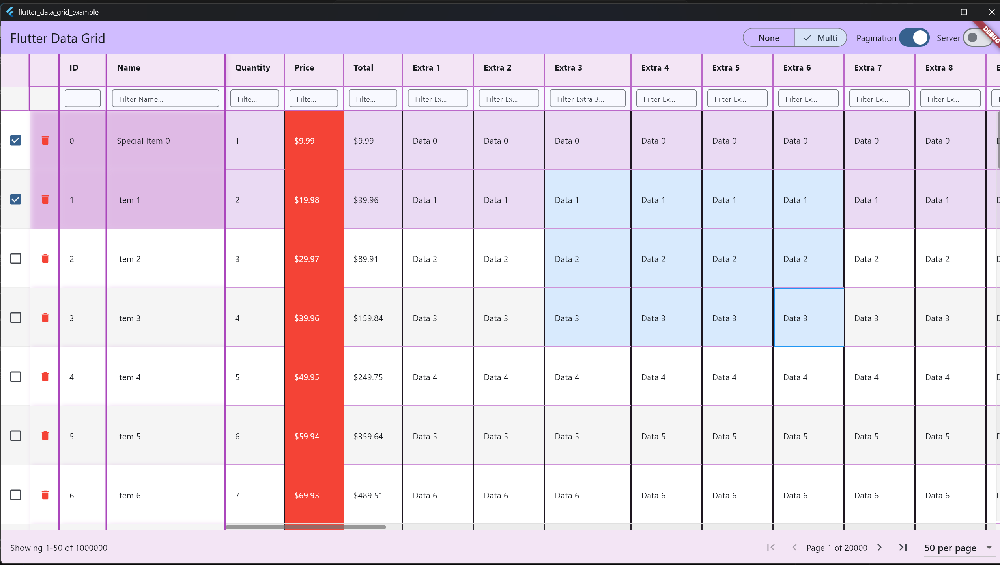

# Flutter Data Grid

A fast, reactive data grid for Flutter. It supports virtualized rendering, sorting, filtering, grouping, cell editing, selection, column pinning and pagination.



**[Live demo](https://archie934.github.io/data_grid/)**: 100k rows, WebAssembly build.

> **Beta.** The core features are stable and tested, but the API may still change. See [Known limitations](#known-limitations).

## Features

- **Virtualized rendering**: only visible cells are built, so 100k+ rows scroll smoothly
- **Columns**: resize, pin, hide/show, and a right-click header menu
- **Sorting and filtering**: single-column sort and per-column filters, run on a background isolate for large datasets
- **Row grouping**: nested, collapsible group header bands
- **Selection**: row selection (checkbox column), cell and range selection, drag-select, Ctrl+C copy as CSV
- **Cell editing**: inline editing with validation and commit callbacks
- **Pagination**: client-side or server-side
- **Theming, interceptors, custom events and pluggable sort/filter delegates**
- **Headless mode**: use the controller without the widget

## Installation

```yaml
dependencies:
  flutter_data_grid: ^0.1.0
```

```dart
import 'package:flutter_data_grid/data_grid.dart';
```

Requires **Flutter 3.47+** (Dart 3.13+). The grid uses the standalone [`material_ui`](https://pub.dev/packages/material_ui) package, so your app's `MaterialApp` must come from `material_ui` too, not from `package:flutter/material.dart`.

## Quick start

```dart
// 1. A row model
class Person extends DataGridRow {
  String name;
  int age;

  Person({required double id, required this.name, required this.age}) {
    this.id = id;
  }
}

// 2. Columns
final columns = [
  DataGridColumn<Person>(
    id: 1,
    title: 'Name',
    width: 200,
    valueAccessor: (row) => row.name,
    cellValueSetter: (row, value) => row.name = value,
    editable: true,
  ),
  DataGridColumn<Person>(
    id: 2,
    title: 'Age',
    width: 100,
    valueAccessor: (row) => row.age,
  ),
];

// 3. A controller (dispose it in State.dispose())
final controller = DataGridController<Person>(
  initialColumns: columns,
  initialRows: people,
);

// 4. The widget
DataGrid<Person>(controller: controller)
```

## Usage

### Columns

```dart
DataGridColumn<MyRow>(
  id: 1,                                       // Unique id
  title: 'Title',
  width: 150,
  pinned: false,                               // Freeze on the left
  visible: true,
  resizable: true,
  sortable: true,
  filterable: true,
  groupable: true,                             // Shows grouping actions in the header menu
  editable: true,
  valueAccessor: (row) => row.value,
  cellValueSetter: (row, value) => row.value = value,
  validator: (oldValue, newValue) => newValue != null,
  cellWidget: const MyCell(),                  // Custom cell (see below)
  filterWidget: const MyFilter(),              // Custom filter (see below)
  cellEditorBuilder: myEditor,
  cellFormatter: (row, column) => 'text',
)
```

Right-clicking a header opens a menu with sort, group, pin and hide actions. You can do the same from code:

```dart
controller.setColumnVisibility(columnId, false);
controller.setColumnPinned(columnId, true);
controller.resizeColumn(columnId, 180);
```

### Data

```dart
controller.setRows(rows);
controller.insertRow(row, position: 0);
controller.insertRows([row1, row2]);
controller.updateRow(rowId, newRow);
controller.updateCell(rowId, columnId, value);
controller.deleteRows({id1, id2});

// You changed a row object yourself, outside the grid: repaint its cells
controller.refreshCells(rowIds: [rowId]);
```

### Sorting and filtering

```dart
controller.sortColumn(1, SortDirection.ascending);
controller.sortColumn(1, null);                    // Clear the sort

controller.filterColumn(1, FilterOperator.contains, 'smith');
controller.clearFilter(columnId: 1);               // Or clearFilter() for all
```

Operators: `equals`, `notEquals`, `contains`, `startsWith`, `endsWith`, `greaterThan`, `lessThan`, `greaterThanOrEqual`, `lessThanOrEqual`, `isEmpty`, `isNotEmpty`. String matching ignores case and extra whitespace.

Sorting a new column replaces the current sort. Sort and filter are debounced (300 ms and 500 ms by default). Above 10,000 rows they run on a background isolate. You can change both through the controller's `sortDebounce`, `filterDebounce`, `sortIsolateThreshold` and `filterIsolateThreshold`.

### Selection

```dart
controller.setSelectionMode(SelectionMode.multiple);   // or SelectionMode.none
controller.selectRow(rowId, multiSelect: true);
controller.selectRowsRange(startId, endId);
controller.clearSelection();

controller.selection$.listen((s) => print(s.selectedRowIds));
```

You can select cells by clicking them. Shift+click and Shift+Arrow extend the selection, Ctrl+click toggles a cell, and a right-click drag selects a rectangle. Ctrl+C copies the selected cells as CSV. From code:

```dart
controller.focusCell(rowId, columnId);
controller.shiftSelectCell(rowId, columnId);
controller.copyCells();
```

**Keyboard shortcuts:** arrows move between rows and cells, Shift+Arrow extends the selection, Escape clears it, Ctrl/Cmd+A selects all, and Ctrl/Cmd+C copies.

### Editing

Double-click an editable cell, or start editing from code:

```dart
controller.startEditCell(rowId, columnId);
controller.updateCellEditValue(newValue);
controller.commitCellEdit();   // or cancelCellEdit()
```

To control what can be edited and saved, pass these callbacks to the controller:

```dart
DataGridController<MyRow>(
  initialColumns: columns,
  initialRows: rows,
  canEditCell: (rowId, columnId) => rowId > 0,
  onCellCommit: (rowId, columnId, oldValue, newValue) async {
    return await save(rowId, columnId, newValue);  // false rejects the edit
  },
);
```

### Grouping

Group from the header menu, or from code. Each call adds a nested level:

```dart
controller.groupByColumn(countryColumnId);
controller.groupByColumn(cityColumnId);              // Country → City
controller.groupByColumn(columnId, replace: true);   // Use this column as the only level
controller.setGroupedColumns([]);                    // Remove all grouping
controller.ungroupColumn(countryColumnId);

controller.expandAllGroups();
controller.collapseAllGroups();
controller.toggleGroupExpansion(groupKey);
```

### Pagination

```dart
controller.enablePagination(true);
controller.setPageSize(25);
controller.nextPage();   // also previousPage, firstPage, lastPage, setPage(n)
```

For server-side pagination, supply loaders:

```dart
final controller = DataGridController<MyRow>(
  initialColumns: columns,
  onLoadPage: (page, pageSize) => api.fetchPage(page, pageSize),
  onGetTotalCount: () => api.count(),
);
controller.enablePagination(true);
controller.setServerSidePagination(true);
```

### Custom cells and filters

A custom cell is a `const` widget that reads its data from `CellScope`. Because the widget is `const`, Flutter can skip rebuilding it. Only the widgets that call `CellScope.of` rebuild when the data changes.

```dart
class ValueCell extends StatelessWidget {
  const ValueCell({super.key});

  @override
  Widget build(BuildContext context) {
    final scope = CellScope.of<MyRow>(context);
    return Text(
      '${scope.value}',
      style: TextStyle(color: scope.row.value > 100 ? Colors.green : Colors.red),
    );
  }
}
```

`CellScope` exposes `row`, `column`, `value`, `rowIndex`, `isSelected`, `isPinned` and `controller`.

A custom filter works the same way, through `FilterScope`. It exposes `column`, `currentFilter`, `onChange(operator, value)` and `onClear()`:

```dart
class MyFilter extends StatelessWidget {
  const MyFilter({super.key});

  @override
  Widget build(BuildContext context) {
    final scope = FilterScope.of(context);
    return TextField(onChanged: (v) => scope.onChange(FilterOperator.contains, v));
  }
}
```

### Row and header height

Row height is fixed by default (`rowHeight`, 48 by default). To size rows or the header to fit their content, pass `autoRowHeight` or `autoHeaderHeight`:

```dart
DataGrid<MyRow>(
  controller: controller,
  autoRowHeight: const AutoRowHeight(estimatedHeight: 56, maxHeight: 200),
  autoHeaderHeight: const AutoHeaderHeight(maxHeight: 120),
)
```

Auto row height is slower to scroll than a fixed height. Keep `estimatedHeight` close to your real row height. Inside cells, avoid `Expanded`, `Spacer`, and `Align` without `heightFactor: 1.0`, because they make a cell fill the maximum height.

### Theming

```dart
DataGrid<MyRow>(
  controller: controller,
  theme: DataGridThemeData(
    colors: DataGridColors(
      headerColor: Colors.blue.shade50,
      selectionColor: Colors.blue.shade100,
    ),
    dimensions: DataGridDimensions(headerHeight: 48, rowHeight: 40),
  ),
)
```

`DataGridThemeData` groups its settings into `colors`, `dimensions`, `padding`, `borders` and `overlay`. Every field is optional.

### Extending the grid

- **Interceptors**: subclass `DataGridInterceptor` and override `onBeforeEvent`, `onBeforeStateUpdate`, `onAfterStateUpdate` or `onError`. Register one with `controller.addInterceptor(...)`. `LoggingInterceptor` and `ValidationInterceptor` are built in.
- **Custom events**: subclass `DataGridEvent`, implement `apply(EventContext context)` to return the new state (or `null` to keep the current one), and dispatch it with `controller.addEvent(...)`.
- **Delegates**: pass a custom `sortDelegate` or `filterDelegate` to the controller to replace the sort or filter algorithm.

## Headless usage

`DataGridController` doesn't depend on widgets. You can use it for the grid's logic and render the state yourself:

```dart
StreamBuilder<DataGridState<Person>>(
  stream: controller.state$,
  initialData: controller.state,
  builder: (context, snapshot) {
    final state = snapshot.data!;
    return ListView(
      children: [
        for (final id in state.displayOrder)
          ListTile(title: Text(state.rowsById[id]!.name)),
      ],
    );
  },
);
```

Read the current state from `controller.state`, or listen to `state$`. To get only one part of the state, listen to `selection$`, `sort$`, `filter$` or `group$`. Edits made with `updateCell` and `commitCellEdit` change the row in place and don't emit a new state. They're reported on `cellValueChanges` instead.

Sorting and filtering are asynchronous, so don't read `state` straight after calling them. For scripts and tests, set the debounces to `Duration.zero` and wait for the matching stream:

```dart
controller.sortColumn(2, SortDirection.descending);
await controller.sort$.firstWhere((s) => s.hasSort);
```

## Performance tips

- Keep `valueAccessor` cheap, and make custom `cellWidget`s `const`.
- Pin only the columns that need it.
- Use a fixed `rowHeight` unless your rows really need to size to their content.
- Always call `controller.dispose()`.
- **On the web, test performance in a release or WebAssembly build** (`flutter run -d chrome --release` or `--wasm`). Debug builds on Chrome are much slower.

## Known limitations

- Keyboard navigation and Tab between cells still have rough edges.
- Cell editing has some edge cases with rapid input.
- When grouping is on, copied cells aren't always in the same order as on screen.
- Only one column can be sorted at a time.
- Column widths aren't saved. Store them yourself if you need them to persist.

**Planned:** drag-and-drop column reordering, accessibility (screen reader) support, row and cell context menus, CSV/Excel export, column auto-sizing, frozen rows.

## Troubleshooting

- **Sort or filter doesn't apply in tests.** Set `sortDebounce` and `filterDebounce` to `Duration.zero`. Before asserting, let the async work finish with `await tester.runAsync(() => Future.delayed(const Duration(milliseconds: 50)))`.
- **"No Material widget found" or "No MaterialLocalizations found".** Your `MaterialApp` comes from `package:flutter/material.dart`. Import it from `material_ui` instead.
- **Clicking doesn't select rows.** Check that the selection mode isn't `SelectionMode.none`.

## Migration guide

### v0.1.0 → next: `groupByColumn` adds a nested level

`groupByColumn(id)` used to replace the current grouping. It now adds the column as the innermost level. To keep the old behavior, call `groupByColumn(id, replace: true)` or `setGroupedColumns([id])`. Top-level group keys (`'$columnId:$value'`) haven't changed. Each nested level appends `'\u001F$columnId:$value'`.

### v0.0.25 → v0.1.0: `material_ui`

The package now imports `package:material_ui/material_ui.dart` and requires Flutter 3.47+. The public API is unchanged. To migrate:

1. Run `flutter pub add material_ui`.
2. Run `dart fix --apply --code=migrate_design_widgets`.
3. Make sure the `MaterialApp`, `Scaffold` and `Theme` above each `DataGrid` come from `material_ui`.

### Older releases

| Version | Change |
|---------|--------|
| v0.0.16 → v0.0.17 | Removed `DataGridRendererType` and the `renderer:` parameter. Removed `DataGridBody`, `DataGridScrollView` and the viewport classes. |
| v0.0.11 → v0.0.12 | Removed `ViewportState`, `ViewportDelegate`, `ScrollEvent`, `ViewportResizeEvent`, `RowRenderer` and `RenderContext`. Replaced `filterRenderer` with `filterWidget` and `FilterScope`. |
| v0.0.9 → v0.0.10 | Replaced `FilterRenderer` with a `const filterWidget` that reads `FilterScope.of(context)`. |
| v0.0.8 → v0.0.9 | Replaced `CellRenderer` and `DataGrid.cellRenderer` with a per-column `const cellWidget` that reads `CellScope.of<T>(context)`. |

## Contributing

Contributions are welcome. Accessibility, keyboard navigation and tests need the most help.

```bash
git clone https://github.com/archie934/data_grid.git
cd data_grid
flutter pub get
dart run build_runner build --delete-conflicting-outputs   # after editing Freezed models
flutter test
cd example && flutter pub get && flutter run
```

## License

See [LICENSE](LICENSE).
